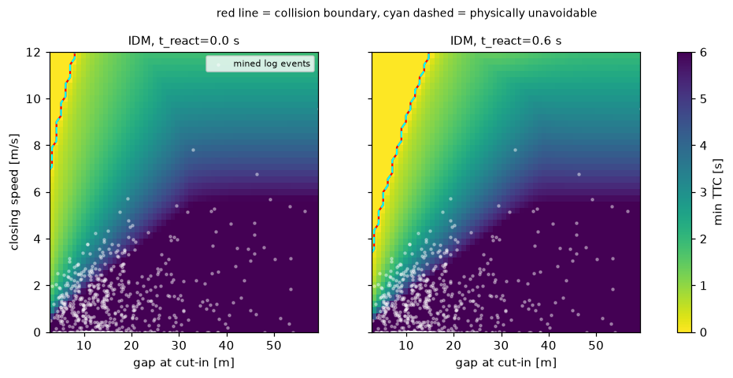
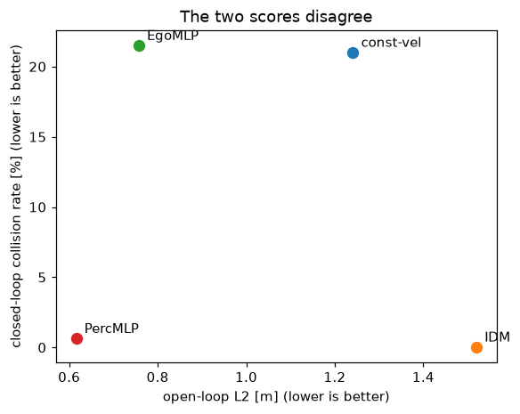

# REPORT — Lab Day 12: Phát lại và kiểm thử vòng kín

| Thông tin | Giá trị |
|---|---|
| Họ và tên | Nguyễn Thành Luân |
| MSSV | 2A202602769 |
| GitHub | [Tluan-source](https://github.com/Tluan-source/K4-Track4-DAY12-NguyenThanhLuan-2A202602769) |
| Seed chia dữ liệu / seed mô hình | 840 / 1195 |
| Số seed huấn luyện | 5: 1195, 1196, 1197, 1198, 1199 |

Chạy đầy đủ bằng MSSV thật, không dùng `--quick`: 6,727 quỹ đạo train và 2,883 quỹ đạo test; 167,020/72,113 cửa sổ train/test. Runtime, phiên bản thư viện và hash dữ liệu/mã nằm trong [runtime.json](evidence/runtime.json); log toàn bộ tại [run_full.txt](evidence/run_full.txt).

## Kết quả cuối

Va chạm là tỷ lệ quỹ đạo test có va chạm; dải là min–max qua 5 seed, không phải CI. L2 là trung bình sai số vị trí tại 1/2/3 giây. Cổng dùng seed xấu nhất và cận trên Wilson, không dùng trung bình. Constant-velocity và IDM là bộ xác định, chạy một lần; chỉ các mô hình học được chạy 5 seed.

| Bộ điều khiển | L2 vòng hở (m), min–max | Va chạm vòng kín trên log (%), min–max | Quyết định cổng |
|---|---|---|---|
| constant-velocity | 1.241–1.241 | 21.02–21.02 | CHẶN |
| IDM | 1.520–1.520 | 0.03–0.03 | baseline |
| EgoMLP | 0.752–0.763 | 15.44–26.08 | CHẶN |
| PercMLP | 0.613–0.618 | 0.42–1.21 | CHẶN |
| PercMLP+ | 0.796–0.831 | 0.10–0.14 | QUA |

Nguồn: [openloop.json](evidence/openloop.json), [closedloop.json](evidence/closedloop.json), [gate.json](evidence/gate.json); dải L2 PercMLP+ được chấm lại từ 5 checkpoint tại [percplus_openloop_per_seed.json](evidence/percplus_openloop_per_seed.json).

## Câu 1 · Dữ liệu

Có ba rủi ro chính: gia tốc xe dẫn không đáng tin, quỹ đạo trùng và các khung liên tiếp có tương quan cao. `Acc_LV` chỉ tương quan 0.04535 với đạo hàm tốc độ, trong khi `Acc_FAV` đạt 0.92909; tôi dùng đạo hàm của `Speed_LV` đã làm mượt để khai thác phanh.
Có 9,993 quỹ đạo thô, bỏ 383 bản trùng còn 9,610; phải loại trùng trước khi chia để tránh bản sao rơi vào cả hai tập. Split theo toàn quỹ đạo, seed 840, tránh dùng khung gần như giống nhau để vừa huấn luyện vừa kiểm thử. Kiểm tra hình học cho offset chiều dài xe 4.5 m, nên dùng bumper gap nhất quán. Nguồn: [data_audit.json](evidence/data_audit.json).

## Câu 2 · Phát lại

Cùng mã chạy lại giống hệt cả 600 đoạn; refactor float32 khác chính xác ở 600 đoạn nhưng 0 đoạn vượt dung sai, sai số lớn nhất 0.00009320 m/s². Dùng |new−golden| ≤ 0,001 + 0,001|golden| vì phép cộng số thực không kết hợp và đổi thứ tự tính có thể đổi bit mà không đổi hành vi đáng kể.
AEB làm lệch 10/600 đoạn. Ở đoạn 60, khung 98–101 có TTC 1,4311–1,4896 s: thấp hơn 1,5 s nên lệnh được kẹp về −6 m/s²; riêng khung 98 đổi từ −5,4363 sang −6. AEB chỉ làm đổi lệnh khi đang tiến gần, TTC dưới ngưỡng và lệnh cũ chưa phanh mạnh bằng −6; không phải mọi khung đều lệch.
Fastest có 0 khung trễ/0 rớt; realtime có 585 trễ và 581 rớt trên 60,037 khung, làm 377 đoạn vượt dung sai. Mô hình chi phí xử lý và lịch timestamp làm lộ việc giữ lệnh cũ khi quá hạn; đây là thời gian mô phỏng, chưa phải đo latency phần cứng thật. Nguồn: [replay.json](evidence/replay.json), [ví dụ AEB sinh từ log](evidence/replay_aeb_example.json).

## Câu 3 · Kịch bản

Lưới có tốc độ cruise 12 m/s, gap 2.760–59.312 m, closing speed 0–12 m/s; 60×45 = 2,700 ô. Biên bất khả thi là gap < Δv·t_react + Δv²/(2b_max), với b_max=9 m/s²; Δv=0 không nằm trong vùng này.
Độ trễ 0→0,6 s làm vùng không thể tránh tăng 2.22%→7.44%; vùng đâm IDM cũng 2.22%→7.44% (+5.22 điểm phần trăm). FullBrake không có ô lệch ngoài dải 5% quanh biên ở cả hai độ trễ; IDM có vùng 'tránh được nhưng vẫn đâm' bằng 0% ở đây.
Khai thác được 614 sự kiện (6.39% quỹ đạo). Mốc phanh người lái mà mã gọi là human_brake_limit là phân vị 99,9% mức giảm tốc 3.625 m/s², không phải cực đại tuyệt đối; 8.56% lưới đòi phanh mạnh hơn mốc này. Các ca từ log chủ yếu không phủ vùng closing speed lớn/gap ngắn, nên học từ log chưa đủ cho cut-in khó. Nguồn: [scenarios.json](evidence/scenarios.json).



## Câu 4 · Vòng hở và vòng kín

Bảng dưới dùng L2 trung bình và tỷ lệ va chạm trung bình qua seed cho đúng cách xếp hạng của đề; cổng ở phần khác vẫn dùng seed xấu nhất.

| Bộ điều khiển | L2 trung bình (m) | Hạng L2 | Va chạm trung bình (%) | Hạng vòng kín |
|---|---|---|---|---|
| const-vel | 1.241 | 3 | 21.02 | 3 |
| IDM | 1.520 | 4 | 0.03 | 1 |
| EgoMLP | 0.757 | 2 | 21.51 | 4 |
| PercMLP | 0.616 | 1 | 0.65 | 2 |

Các cặp đảo thứ tự: **const-vel ↔ IDM; const-vel ↔ EgoMLP; IDM ↔ EgoMLP; IDM ↔ PercMLP**. IDM có L2 cao vì không cố bắt chước chính xác quỹ đạo người lái, nhưng dùng gap và vận tốc tương đối để phanh nên vẫn ít va chạm. EgoMLP dự đoán tốt hơn constant-velocity trên log vì học quán tính/thói quen tốc độ, nhưng thiếu trạng thái xe dẫn; khi tự lái, trạng thái lệch log và lỗi tích lũy thành va chạm. PercMLP có nhận thức nên tốt hơn EgoMLP trong nhiều ca, nhưng log ít cut-in khó; L2 trung bình cũng che lát cắt phanh chỉ chiếm 4.44% cửa sổ. Nguồn: [closedloop.json](evidence/closedloop.json), [openloop.json](evidence/openloop.json).



## Câu 5 · Một lần chạy chưa đủ

EgoMLP va chạm 15.44–26.08% qua seed 1195–1199, chênh 10.65 điểm phần trăm. Seed tốt nhất 1198: 445/2883, CI95 [14.16; 16.80]%; seed xấu nhất 1199: 752/2883, CI95 [24.51; 27.72]%.
CI95 của seed tốt nhất và xấu nhất không chồng lấp trong lần chạy này; đây là dấu hiệu độ nhạy seed đáng kể trên split này. Wilson thể hiện bất định tỷ lệ trên tập quỹ đạo hữu hạn; dải seed thể hiện độ nhạy với khởi tạo và thứ tự học. Hai nguồn bất định khác nhau, không được dùng dải min–max làm CI hay gộp các seed thành các quỹ đạo độc lập. Chọn riêng seed tốt sẽ báo rủi ro thấp hơn các lần chạy còn lại; cần báo đủ 5 seed, cận trên và seed xấu nhất. Nguồn: [closedloop.json](evidence/closedloop.json), `logs.EgoMLP.per_seed`.

## Câu 6 · Tác nhân phản ứng

Hiệu chỉnh trên tập train chọn T=1.4 s với W1=0.344 s giữa phân bố time headway mô phỏng và người lái; tác nhân không phản ứng có W1=0.886 s. Median headway người lái 1.853 s; rear gap=18.8 m và trễ xe sau=0.6 s. W1 nhỏ hơn chỉ chứng minh khớp một phân bố trên dữ liệu hiệu chỉnh, chưa chứng minh mô hình người lái đầy đủ.

Tỷ lệ ô có va chạm ở t_react=0,6 s; bảng của đề chọn seed xấu nhất theo ANY khi xe sau phản ứng cho từng mô hình.

| Xe sau phát lại | Va chạm trước (%) | Sau (%) | ANY (%) |
|---|---|---|---|
| const-vel | 77.63 | 0.00 | 77.63 |
| IDM | 7.44 | 68.30 | 75.74 |
| EgoMLP | 81.00 | 0.00 | 81.00 |
| PercMLP | 22.81 | 52.89 | 75.59 |
| PercMLP+ | 7.74 | 68.37 | 76.11 |

| Xe sau phản ứng | Va chạm trước (%) | Sau (%) | ANY (%) |
|---|---|---|---|
| const-vel | 77.63 | 0.00 | 77.63 |
| IDM | 7.44 | 0.00 | 7.44 |
| EgoMLP | 81.00 | 0.00 | 81.00 |
| PercMLP | 24.00 | 0.00 | 24.00 |
| PercMLP+ | 7.78 | 0.00 | 7.78 |

IDM bị xe sau phát lại đâm từ sau ở 68.30% ô, giảm còn 0.00% khi xe sau phản ứng. Xe phát lại giữ chuyển động cũ dù ego vừa phanh tránh cutter, nên gán tất cả các va chạm đó cho ego tạo kết luận sai trong thế giới mô phỏng. Khi đổi tác nhân, ANY của IDM chuyển 75.74%→7.44%; phải xem cả va chạm trước/sau và giả định hành vi, thay vì thưởng bộ điều khiển ít phanh chỉ vì ít bị đâm sau. Nguồn: [agents.json](evidence/agents.json).

## Câu 7 · Cổng phát hành và sửa

Các quy tắc thất bại của từng ứng viên, lấy nguyên quyết định cổng (IDM là baseline):

- **const-vel: CHẶN**; quy tắc rớt: R2, R3, R4, R6.
- **EgoMLP: CHẶN**; quy tắc rớt: R2, R3, R4, R5, R6.
- **PercMLP: CHẶN**; quy tắc rớt: R2, R3, R4, R6.
- **PercMLP+: QUA**; quy tắc rớt: không có (qua cả 7 quy tắc).

| Quy tắc | PercMLP | PercMLP+ |
|---|---|---|
| R1_replay_reproducible | Qua: rerun identical and refactor differs beyond tol in 0 segments | Qua: rerun identical and refactor differs beyond tol in 0 segments |
| R2_closed_loop_logs | Rớt: candidate upper 95% 1.684% <= baseline 0.035% + 1.000 points (1.035%): False | Qua: candidate upper 95% 0.356% <= baseline 0.035% + 1.000 points (1.035%): True |
| R3_braking_slice | Rớt: 6.1 % (n=196, upper 10.4 %) vs baseline 0.5 % + 5 points | Qua: 0.5 % (n=196, upper 2.8 %) vs baseline 0.5 % + 5 points |
| R4_scenario_grid | Rớt: avoidable collision area 16.556% <= baseline 0.000% + 2.000 points (2.000%): False | Qua: avoidable collision area 0.333% <= baseline 0.000% + 2.000 points (2.000%): True |
| R5_seed_stability | Qua: 0.4 .. 1.2 % over 5 run(s) | Qua: 0.1 .. 0.1 % over 5 run(s) |
| R6_reactive_world | Rớt: 24.0 % of the grid vs baseline 7.4 % | Qua: 7.8 % of the grid vs baseline 7.4 % |
| R7_coverage | Qua: 614 mined events, 2700 grid cells | Qua: 614 mined events, 2700 grid cells |

PercMLP tự lái lệch phân bố trạng thái, dẫn tới va chạm log 0.42–1.21%; đây là lỗi tích lũy mà DAgger nhắm tới. Vùng cut-in tránh được nhưng vẫn đâm là 16.56% và ANY với xe sau phản ứng là 24.00%; chúng bộc lộ thiếu kịch bản khó trong log, được xử lý bằng 20,000 cut-in sinh mô phỏng.
Tôi gắn nhãn từ IDM tại chính các trạng thái mô hình tự đi vào, học lại 2 vòng DAgger. Sau sửa, va chạm log 0.10–0.14%, vùng cut-in lỗi còn 0.33%, L2 trung bình đổi 0.616→0.811 m. Cổng PercMLP+ quyết định **QUA**; không đổi ngưỡng để có kết quả này.
Hai biện pháp được áp dụng cùng nhau; chưa có ablation để định lượng riêng tác dụng của cut-in và DAgger. Quyết định cổng chỉ áp dụng cho phạm vi phép thử và không chứng minh PercMLP+ tốt hơn IDM. PercMLP+ học từ IDM nên cần so riêng chi phí, độ bền và ca ngoài miền trước khi thay baseline; ở tốc độ giữ lại 20 m/s, ngoài vùng cut-in huấn luyện ≤16 m/s, vùng lỗi của PercMLP+ là 0.33–1.22% so với IDM 0.00–0.00%. Tôi đề xuất giữ IDM, mở rộng kiểm thử ngoài miền và shadow testing trước quyết định phát hành thực tế. Nguồn: [gate.json](evidence/gate.json), [fix.json](evidence/fix.json).

## Câu 8 · Bài lab này không chứng minh được gì

Thứ nhất, mô phỏng chỉ dọc 1D, dt=0,1 s và xe dẫn phát lại không phản ứng với ego; kết quả 2,883 log test không bao quát hành vi tương tác nhiều làn. Cần kịch bản đổi làn, người đi bộ và tác nhân có nhiều kiểu phản ứng.
Thứ hai, quan sát gần như lý tưởng; thử nhiễu khoảng cách 1 m và vận tốc 0,5 m/s chưa thay thế lỗi phát hiện, mất track hay timestamp của cảm biến thật. Realtime phát hiện 585 khung trễ trong mô hình chi phí, chưa đo được phân bố trễ end-to-end trên phần cứng đích.
Thứ ba, 2,700 ô lưới và 614 ca phanh không là phân bố giao thông thực; tỷ lệ ô không phải xác suất tai nạn trên đường. Mốc 20 m/s giữ lại trong fix cho thấy phải đánh giá ngoài miền và mở rộng vùng thử, thay vì chỉ đọc điểm tổng.
Thứ tư, 5 seed vẫn dùng một split cố định; Wilson không bao trùm sai mô hình, trôi miền hay tương quan giữa quỹ đạo. Cần nhiều split theo bối cảnh, nguồn dữ liệu độc lập, kiểm thử dài hạn và đánh giá có giám sát. Vì vậy quyết định cổng của lab là điều kiện để tiếp tục thử nghiệm, chưa đủ để cho phép vận hành thật. Nguồn cho phạm vi thử: [runtime.json](evidence/runtime.json), [closedloop.json](evidence/closedloop.json), [fix.json](evidence/fix.json).

## Tái lập và kiểm tra

Chỉ thân 10 hàm TODO được cài; các file tests, simulator, pipeline và ngưỡng cổng giữ nguyên bộ đề. Chạy trong môi trường UTF-8; khi tái lập dùng một luồng BLAS để giảm khác biệt do số học song song. Dữ liệu và `work/` không commit.

```bash
python run_all.py --student-id 2A202602769 --seeds 5
python -m unittest discover -s tests -v
python scripts/check_submission.py --save-verify
```

Trên PowerShell có thể đặt `$env:PYTHONUTF8="1"`, `$env:OPENBLAS_NUM_THREADS="1"`, `$env:OMP_NUM_THREADS="1"`, `$env:MKL_NUM_THREADS="1"` trước khi chạy. Evidence số liệu do mã sinh ra; không chỉnh tay.

Kết quả kiểm tra: 25 unit test đạt; [38 đối chiếu mã và bằng chứng](evidence/local_audit.json) đều qua. Biên bản checker cuối lưu tại [evidence/verify.txt](evidence/verify.txt).
